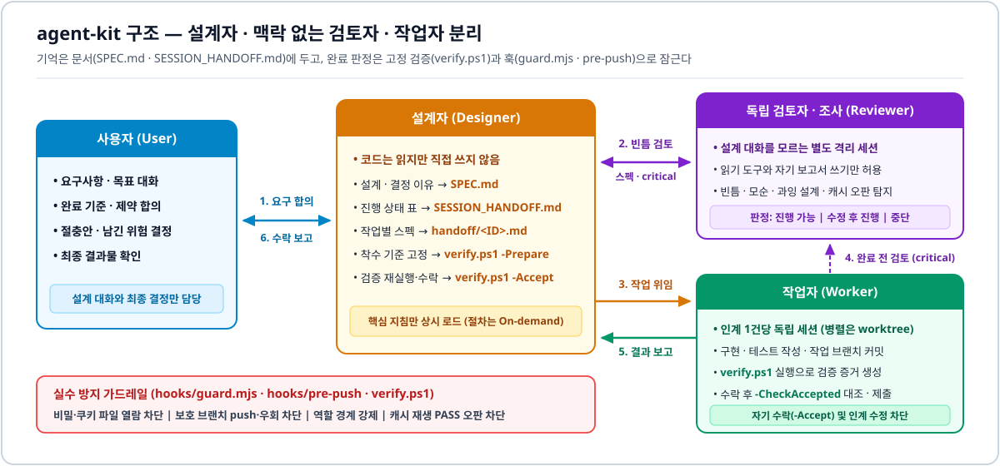

# agent-kit

똑똑한 **설계자(Designer)** 하나가 사용자와 대화하며 프로젝트를 설계하고, 대화 맥락을 모르는 **독립 검토자(Reviewer)** 세션이 그 설계의 빈틈을 찾으며, 구현과 검증은 **작업자(Worker)**가 맡는 멀티 에이전트 작업 하네스(지침·스크립트·훅 묶음)다.

실제 프로젝트에서 겪은 실패와 시행착오를 바탕으로 정립한 목적과 13가지 원칙(`PRINCIPLES.md`)을 중심으로 동작하며, 규칙을 더하거나 뺄 때는 언제나 그 문서를 기준으로 삼는다(설계 배경과 7대 핵심 철학 해설은 [DESIGN_PHILOSOPHY.md](./DESIGN_PHILOSOPHY.md) 참고).

## 핵심 구조와 특징



1. **만든 쪽과 확인하는 쪽의 철저한 분리 (`DESIGNER` / `REVIEWER` / `WORKER`)**
   - **설계자**: 코드를 직접 쓰지 않고 사용자와 대화하며 목표·완료 기준·하지 않을 것·결정 이유를 `SPEC.md`와 작업별 인계 파일(`handoff/<ID>.md`)로 만든다.
   - **맥락 없는 독립 검토자**: 설계자와의 대화 맥락을 전혀 물려받지 않는 별도 헤드리스 세션에서 오직 문서와 코드만 읽고 빈틈·모순·과잉 설계를 찾는다.
   - **작업자**: 인계 하나당 세션 하나로 격리되어 구현·테스트·고정 검증(`verify.ps1`)·Git 제출만 수행한다.
   - **이종 에이전트 교차 배치**: Codex·Claude Code·Antigravity 중 원하는 도구를 역할별로 자유롭게 조합하며, `AGENTS.md` 표 한 곳만 고치면 역할을 즉시 교체할 수 있다(3사 모두 `AGENTS.md`를 네이티브로 자동 로드하며, 기존 프로젝트 고유 `CLAUDE.md`가 따로 있을 때만 `@AGENTS.md` 한 줄을 둔다).
2. **말이 아닌 실행 근거로 잠그는 경량 결정론적 검증 (`verify.ps1` + `hooks/pre-push`)**
   - 설계자가 착수 전 `verify.ps1 -Prepare`로 인계 해시·`SPEC.md` 해시·비교 기준 커밋을 고정한다.
   - 빌드 캐시 재생(Gradle `UP-TO-DATE`/`SKIPPED`, Go `(cached)`/`[no test files]`, Turborepo/Nx 캐시), 테스트 0건 실행, 미추적 파일·더티 트리를 모두 실패로 잡아내며, 기존 테스트 삭제·skip·단언 약화 신호(`test-changes.txt`)와 명령 실패 시 줄 번호가 붙은 핵심 에러 발췌(`FAILURE-EXCERPT`)를 자동 추출한다.
   - 설계자의 `verify.ps1 -Accept`는 무거운 테스트를 중복 재실행하지 않고 작업자가 남긴 실행 증거(`run.json`)·인계 해시·클린 트리를 즉시 대조해 로컬 수락 기록(`accepted.json`)을 남기며(`critical`은 검토 보고서의 판정·`검토 commit`·`검증 경로`(`OUT`) 일치까지 필수 검증, 수동 검증 Git 작업은 `-Accept -Manual`), 커밋 해시가 일치하지 않으면 `pre-push` 훅과 `-CheckAccepted`가 제출을 차단한다.
3. **3사 에이전트 공통 실수 방지 가드레일 (`hooks/guard.mjs`)**
   - Claude Code·Codex·Antigravity 공통 `PreToolUse` 훅으로 비밀 파일(`.env`, SSH 키·인증서, 클라우드 자격증명, 테스트 쿠키) 열람, 보호 브랜치 직접 push 및 `--no-verify` 우회, 훅·권한 우회 플래그, 하위 세션·작업자의 역할 경계 이탈, 호출 폭주·무한 루프를 실시간 차단한다.
   - 상위 AI가 하위 터미널 화면을 읽어 승인 키를 대신 누르는 위험한 대리 클릭 대신, 단발성 검토·조사는 헤드리스 모드로 실행하고 작업자의 통상 로컬 명령은 세션 시작 시 선언적 권한 설정으로 허용한다.
4. **가벼운 Always-on 지침과 통제된 온디맨드 경험 환류 (`EXPERIENCE.md` · `probes/`)**
   - 매번 읽는 파일(`AGENTS.md` + 역할 파일 1개)에는 구조화된 핵심 행동 규칙만 두고, 세부 운영 절차(`RUNBOOK.md`)·위임 스킬(`skills/`)·실패 회고(`EXPERIENCE.md`)는 필요할 때만 읽는 On-demand로 분리한다.

## 요구 환경 및 초기 설정 (최초 1회)
- **요구 환경**: Windows (Windows PowerShell 5.1+ 또는 `pwsh`), macOS·Linux (`pwsh` PowerShell 7+, `/bin/sh`), Git, Node.js 18+, 사용할 에이전트 CLI(Codex / Claude Code / Antigravity 중 1개 이상), 선택 사항으로 대화형 작업자 세션 오케스트레이션용 **Herdr(`hc`)**.
1. 저장소를 **공백이나 셸 특수문자(`& ; | < > ( ) ' " [ ]`)가 없는 중앙 경로 한 곳**(`<agent-kit>`, 예: `C:/Users/<user>/agent-kit` 또는 `~/agent-kit`)에 클론한다(작업할 개별 프로젝트 폴더 안에 클론하지 않는다).
2. **원클릭 자동 설정 (`install.ps1`, 권장)**:
   - Windows: `powershell -NoProfile -ExecutionPolicy Bypass -File <agent-kit>/install.ps1`
   - macOS·Linux: `pwsh -NoProfile -File <agent-kit>/install.ps1`
   - 이 한 줄로 **스킬 3종(`agent-kit-start`, `agent-delegate`, `agent-session-cleanup`) 글로벌 등록**(Claude·Codex 정션/심볼릭 링크, Antigravity 네이티브 `~/.gemini/config/skills.json`)과 **3사 에이전트 `PreToolUse` 실수 방지 훅(`guard.mjs`) 병합 등록**, 차단 자가 점검까지 자동으로 완료된다(연결 해제 시 `-Uninstall`).
3. **내 기본 역할·모델 고정 (선택, `local-defaults.json`)**:
   - 새 프로젝트를 시작할 때마다 기본으로 채울 역할·모델 조합이 있으면 `<agent-kit>/local-defaults.json`(Git 제외 파일)에 실제 CLI 모델 ID를 적어 둔다:
     ```json
     {
       "designer": "Codex(모델은 사용자 선택)",
       "designerLaunch": "사용자가 `codex --no-daemon`으로 시작",
       "worker": "Claude. 가벼운 프로젝트 `<표준 모델 ID>` / 무거운 프로젝트 `<고성능 모델 ID>`",
       "reviewer": "Antigravity 일반·조사 `<표준 모델 ID>` / 중요 `<고성능 모델 ID>`"
     }
     ```

## 시작하는 법
- **새 프로젝트**:
  - **Herdr(`hc`) 자동 위임 모드(기본)**: Herdr 터미널의 프로젝트 폴더에서 설계자 에이전트를 시작하고(Codex면 `codex --no-daemon`) `"agent-kit으로 시작하자. <만들고 싶은 것>"`이라고 입력한다.
  - **일반 터미널 모드(Herdr가 없을 때)**: 일반 터미널에서 똑같이 입력하고 **수동 작업자 인계 모드(`-CrossAgentMode manual`)**로 진행한다. 단발성 빈틈 검토·조사는 수동 모드에서도 헤드리스 CLI 호출로 자동 수행되며, 대화형 작업자만 별도 터미널 탭에서 파일 인계로 주고받는다.
  - 팀이나 여러 PC에서 스펙(`SPEC.md`·`AGENTS.md`)을 Git으로 함께 버전 관리하려면 초기화 시 `-TrackSpec` 옵션을 함께 쓴다.
- **기존 프로젝트 재개**: 프로젝트 폴더에서 설계자를 시작하고 `"SPEC.md와 SESSION_HANDOFF.md를 읽고 이어서 진행하자"`라고 입력한다. 키트 폴더 경로를 옮긴 뒤에는 `init.ps1 -Target <프로젝트 폴더>`를 한 번 실행하면 기존 지침 파일 안의 옛 키트 경로와 미치환 토큰이 자동으로 갱신된다.
- **예외로 멈췄을 때**:
  - **한도 소진 / 모델 교체**: `AGENTS.md` 역할 배정 표의 모델만 바꾸고 새 세션에서 `"SPEC.md와 SESSION_HANDOFF.md를 읽고 이어서 진행하자"`로 재개한다.
  - **연속 실행 간격·호출 상한 차단(`guard.mjs`)**: AGY 연속 실행 30초 간격 또는 `hc` 무한 루프 상한에 걸리면 원인과 대상 터미널 화면(`hc read`)을 확인한 뒤 재개한다(이력은 Windows `%LOCALAPPDATA%/agent-kit/hc-rate.json`, macOS·Linux `~/.cache/agent-kit/hc-rate.json`에 최근 60분만 보관).
  - **권한 확대 승인 창 / 훅 차단**: 설계자가 알린 대상 터미널에서 사용자가 직접 승인·거부하거나 원인을 해결한 뒤 이어서 진행하라고 알린다.

## 구성
| 위치 | 내용 | 읽는 쪽 |
|---|---|---|
| `PRINCIPLES.md` | 목적과 13가지 원칙 | 사람, 키트를 고치는 세션 |
| `DESIGN_PHILOSOPHY.md` | 7대 설계 철학 해설 (자동 강제·판단·외부 설정의 구분) | 사람 참고용 (작업 세션은 읽지 않음) |
| `skills/agent-kit-start/SKILL.md` | 새 프로젝트 초기화·설계 시작 절차 | 설계자, 한 번 |
| `templates/AGENTS.md` | 3사 공통 자동 진입 지침과 역할 배정 표 (`init.ps1`이 치환해 복사) | 모든 역할 |
| `templates/SPEC.md` | 프로젝트의 기억: 목표·완료 기준·하지 않을 것·결정과 이유 | 설계자가 쓰고 모두 읽는다 |
| `templates/SESSION_HANDOFF.md` | 진행 상태 표 | 설계자·작업자 |
| `templates/agent-roles/DESIGNER.md` | 대화·스펙·빈틈 찾기·위임과 수락 | 설계자 |
| `templates/agent-roles/WORKER.md` | 구현·검증·보고·merge | 작업자 |
| `templates/agent-roles/REVIEWER.md` | 빈틈 검토, 완료 전 검토, 조사 | 검토자·조사 |
| `templates/handoff/_TEMPLATE.md` | 작업 하나의 스펙(인계) 양식 | 설계자가 채운다 |
| `skills/agent-delegate` | 다른 세션에 일을 맡기는 방법(헤드리스 검토·조사, 작업자 실행 `worker.md`) | 설계자·작업자 |
| `RUNBOOK.md` | 도구 경로, hc·agy 요령, 확인된 제약, 에이전트 카탈로그, 반복 실패 시 하네스 수정(15절) | 막혔을 때 해당 절만 |
| `install.ps1` | 최초 1회 글로벌 스킬 3종 등록 및 3사 `guard.mjs` 훅 병합 설치 (`-Uninstall` 지원) | 사용자 (최초 1회) |
| `init.ps1`, `git-exclude.txt` | 템플릿 복사(경로 갱신 포함), Git 제외(`-TrackSpec` 선택 가능)와 `pre-push` 설치 | 설계자·작업자가 실행 |
| `verify.ps1` | 인계 기준 고정(`-Prepare`), 검증 실행, 경량 수락(`-Accept` / `-Accept -Manual`), 제출 대조(`-CheckAccepted`) | 작업자·설계자가 실행 |
| `check-tools.ps1`, `tool-versions.txt` | 에이전트 도구 버전 변경 및 훅 무결성 점검. 반영 절차는 RUNBOOK 14절 | `init.ps1`이 실행 |
| `hooks/guard.mjs`, `hooks/pre-push` | 실수 방지 훅(비밀 파일, 보호 브랜치·미수락 push, 우회 플래그, 역할 경계, 폭주 방지) | 도구가 실행 |
| `probes/` | 모델·도구 교체 및 지침 변경 전/후 행동 대조용 시험 재료와 결과 표 | 키트 유지보수 세션 |
| `EXPERIENCE.md` | 실사용 회고에서 추린 범용(Invariant) 교훈 누적 기록(On-demand) | 키트 유지보수 세션, 회고 요청 시 설계자(2절) |

부속 도구(세션과 디스크를 정리할 때 쓴다): `cleanup.ps1`, `skills/agent-session-cleanup`.

## CLI 일괄 업데이트 (`update-tools.ps1`, `update-tools.sh`)
Windows와 WSL 한 배포판의 `codex`·`claude`·`agy` CLI를 각 도구의 `update` 명령으로 올린다.
```powershell
$s = '<agent-kit>/update-tools.ps1'
powershell -NoProfile -ExecutionPolicy Bypass -File $s                        # 미리보기
powershell -NoProfile -ExecutionPolicy Bypass -File $s -Apply                 # 실제 업데이트(Windows + WSL Ubuntu)
powershell -NoProfile -ExecutionPolicy Bypass -File $s -Apply -WindowsOnly    # Windows만
powershell -NoProfile -ExecutionPolicy Bypass -File $s -Distro Ubuntu         # 대상 배포판 지정
```
- 테스트: `node update-tools.test.mjs` (Windows는 모의 실행 파일만 쓰며, 호스트에 WSL `Ubuntu`가 있으면 `/tmp/updtest-*` 격리 폴더에서 `update-tools.sh`도 함께 시험한다).

## 고칠 때
- **배치 위치와 중복 먼저 확인(원칙 1·3)**: 새 규칙은 먼저 필요할 때만 읽는 곳(`RUNBOOK.md`·`skills/`·스크립트·훅)에 둘 수 있는지 본다. 항상 읽는 지침(`templates/AGENTS.md`·역할 파일)에 넣어야 할 때는 중복·낡은 문장을 함께 덜어낸다.
- **회귀 테스트 + 행동 대조**: 훅·`install.ps1`·`init.ps1`·`verify.ps1`·`cleanup.ps1`·`update-tools.ps1`을 고치면 `node test.mjs`(회귀 테스트 6종 일괄 실행)를 돌린다. 역할 지침의 핵심 절차를 고치면 `probes/README.md`의 변경 전/후 행동 대조로 회귀를 확인한다.
- **경험 환류와 병합**: 프로젝트 회고(`handoff/retro.md`)에서 채택한 `[범용 / Invariant]` 교훈을 반영하면 `EXPERIENCE.md` 표에 패턴·검증 테스트를 남기고, 템플릿 변경은 기존 프로젝트에 RUNBOOK 11절(병합)로 반영한다.
