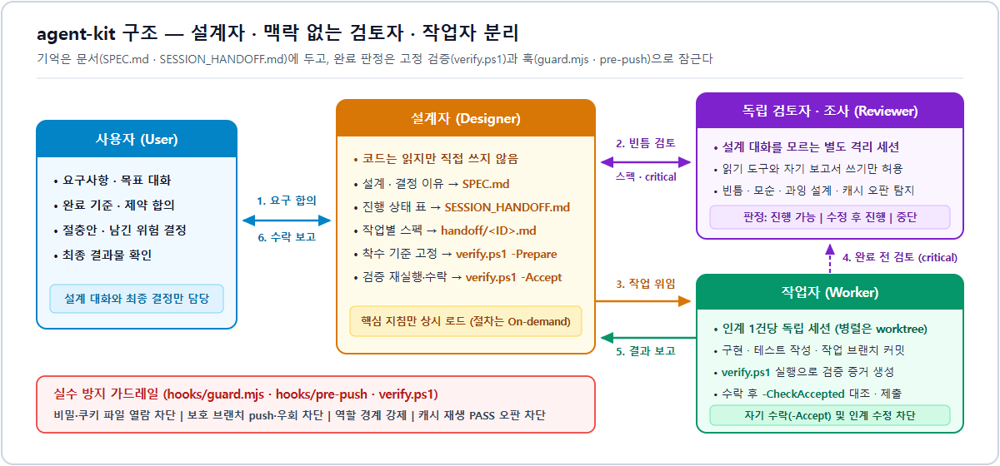

# agent-kit

똑똑한 **설계자(Designer)** 하나가 사용자와 대화하며 프로젝트를 설계하고, 대화 맥락을 모르는 **독립 검토자(Reviewer)** 세션이 그 설계의 빈틈을 찾으며, 구현과 검증은 **작업자(Worker)**가 맡는 멀티 에이전트 작업 하네스(지침·스크립트·훅 묶음)다.

실제 프로젝트에서 겪은 실패와 시행착오를 바탕으로 직접 정립한 목적과 13가지 원칙(`PRINCIPLES.md`)을 중심으로 동작하며, 규칙을 더하거나 뺄 때는 언제나 그 문서를 기준으로 삼는다.

## 핵심 구조와 특징



1. **만든 쪽과 확인하는 쪽의 철저한 분리 (`DESIGNER` / `REVIEWER` / `WORKER`)**
   - **설계자**: 코드를 직접 쓰지 않고 사용자와 대화하며 목표·완료 기준·하지 않을 것·결정 이유를 `SPEC.md`와 작업별 인계 파일(`handoff/<ID>.md`)로 만든다.
   - **맥락 없는 독립 검토자**: 설계자와의 대화 맥락을 전혀 물려받지 않는 별도 세션에서 오직 문서와 코드만 읽고 빈틈·모순·과잉 설계를 찾는다.
   - **작업자**: 인계 하나당 세션 하나로 격리되어 구현·테스트·고정 검증(`verify.ps1`)·Git 제출만 수행한다.
   - **이종 에이전트 교차 배치**: Codex·Claude Code·Antigravity 중 원하는 도구를 역할별로 자유롭게 조합하며, `AGENTS.md` 표 한 곳만 고치면 역할을 즉시 교체할 수 있다.
2. **말이 아닌 실행 근거로 잠그는 결정론적 검증 (`verify.ps1` + `hooks/pre-push`)**
   - 설계자가 착수 전 `verify.ps1 -Prepare`로 인계 해시·`SPEC.md` 해시·비교 기준 커밋을 고정한다.
   - 빌드 캐시 재생(Gradle `UP-TO-DATE`/`SKIPPED`, Go `(cached)`), 테스트 0건 실행, 미추적 파일·더티 트리를 모두 실패로 잡아내며, 기존 테스트 삭제·skip·단언 약화 신호(`test-changes.txt`)를 자동 추출한다.
   - 설계자의 `verify.ps1 -Accept` 수락 기록(`accepted.json`)과 커밋 해시가 일치하지 않으면 `pre-push` 훅과 `-CheckAccepted`가 제출을 차단한다.
3. **3사 에이전트 공통 실수 방지 가드레일 (`hooks/guard.mjs`)**
   - Claude Code·Codex·Antigravity 공통 `PreToolUse` 훅으로 비밀 파일(`.env`, 키·인증서, 테스트 쿠키·자격증명) 열람, 보호 브랜치 직접 push 및 `--no-verify` 우회, 권한 우회 플래그, 하위 세션·작업자의 역할 경계 이탈, 호출 폭주·무한 루프를 실시간 차단한다.
4. **가벼운 Always-on 지침과 통제된 온디맨드 경험 환류 (`EXPERIENCE.md` · `probes/`)**
   - 매번 읽는 파일(`AGENTS.md` + 역할 파일 1개)에는 핵심 행동 규칙만 두고, 세부 운영 절차(`RUNBOOK.md`)·위임 스킬(`skills/`)·실패 회고(`EXPERIENCE.md`)는 필요할 때만 읽는 On-demand로 분리한다.
   - 에이전트가 임의로 메모리를 쌓아 컨텍스트를 오염시키는 대신, 실사용에서 확인된 범용 실패 패턴(`[범용 / Invariant]`)만 온디맨드 회고와 정량 시험(`probes/`)을 거쳐 반영한다.

## 요구 환경 및 초기 설정 (최초 1회)
- **요구 환경**: Windows (Windows PowerShell 5.1+ 또는 `pwsh`), macOS·Linux (`pwsh` PowerShell 7+, `/bin/sh`), Git, Node.js 18+, 사용할 에이전트 CLI(Codex / Claude Code / Antigravity 중 1개 이상), 선택 사항으로 자동 세션 오케스트레이션용 **Herdr(`hc`)**. (macOS·Linux에서 `powershell` 명령이 없으면 `pwsh`로 실행하거나 `ln -s "$(command -v pwsh)" /usr/local/bin/powershell` 심볼릭 링크를 둔다.)
1. 저장소를 **공백이나 셸 특수문자(`& ; < > [ ]`)가 없는 중앙 경로 한 곳**(`<agent-kit>`, 예: `C:/Users/<user>/agent-kit` 또는 `~/agent-kit`)에 클론한다(작업할 개별 프로젝트 폴더 안에 클론하지 않는다).
2. **원클릭 자동 설정 (`install.ps1`, 권장)**:
   - Windows: `powershell -NoProfile -ExecutionPolicy Bypass -File <agent-kit>/install.ps1`
   - macOS·Linux: `pwsh -NoProfile -File <agent-kit>/install.ps1`
   - 이 한 줄로 **스킬 3종(`agent-kit-start`, `agent-delegate`, `agent-session-cleanup`) 글로벌 연결**과 **3사 에이전트 `PreToolUse` 실수 방지 훅(`guard.mjs`) 경로 치환·병합 등록**, 차단 자가 점검까지 자동으로 완료된다(기존 설정은 보존하며, 연결만 해제할 때는 `-Uninstall`을 붙인다).
3. **수동 설정 참고 (직접 연결·확인할 때만)**:
   - **스킬 3종 연결 (`RUNBOOK.md` 1절)**: Claude Code(`~/.claude/skills/<이름>`)·Codex(`~/.agents/skills/<이름>`)는 Windows 정션(`cmd /c mklink /J`) 또는 macOS·Linux 심볼릭 링크(`ln -s`)로 연결하고, Antigravity(`~/.gemini/config/skills/<이름>/SKILL.md`)는 원본 경로를 가리키는 실제 연결 파일을 둔다.
   - **PreToolUse 훅 등록 (`RUNBOOK.md` 9절)**: `hooks/agy-hooks.json`(`~/.gemini/config/hooks.json`), `hooks/codex-hooks.json`(`~/.codex/hooks.json`), Claude(`~/.claude/settings.json`의 `hooks.PreToolUse`)에 `<agent-kit>`을 실제 슬래시(`/`) 절대 경로로 치환해 등록한다.
4. **내 기본 역할·모델 고정 (선택, `local-defaults.json`)**:
   - 새 프로젝트를 시작할 때마다 기본으로 채울 역할·모델 조합이 있으면 `<agent-kit>/local-defaults.json`(Git 제외 파일)에 실제 CLI 모델 ID를 적어 둔다:
     ```json
     {
       "designer": "Codex(모델은 사용자 선택)",
       "designerLaunch": "사용자가 `codex --no-daemon`으로 시작",
       "worker": "Claude. 가벼운 프로젝트 `<표준 모델 ID>` / 무거운 프로젝트 `<고성능 모델 ID>`",
       "reviewer": "Antigravity 일반·조사 `<표준 모델 ID>` / 중요 `<고성능 모델 ID>`"
     }
     ```

## 시작하는 법
- **새 프로젝트**:
  - **Herdr(`hc`) 자동 위임 모드(기본)**: Herdr 터미널의 프로젝트 폴더에서 설계자 에이전트를 시작하고(Codex면 `codex --no-daemon`, 자식 실행에 `HC_TERMINAL_ID`가 필요) `"agent-kit으로 시작하자. <만들고 싶은 것>"`이라고 입력한다.
  - **일반 터미널 수동 인계 모드(Herdr가 없을 때)**: 일반 터미널에서 설계자를 시작해 똑같이 입력하고, 설계자가 물으면 **수동 인계 모드(`-CrossAgentMode manual`)**로 진행하겠다고 답한다(작업자·검토자 CLI 명령을 사용자가 새 터미널 탭에 직접 실행하고 파일로 인계·보고를 주고받는다).
  - 시작 스킬을 찾지 못하면 `<agent-kit>/skills/agent-kit-start/SKILL.md`를 읽으라고 한다. 프로젝트마다 역할을 다르게 배정하려면 `"설계자=<…>, 작업자=<…>, 검토자=<…>"`를 덧붙인다.
- **기존 프로젝트 재개**: 프로젝트 폴더에서 설계자를 시작하고 `"SPEC.md와 SESSION_HANDOFF.md를 읽고 이어서 진행하자"`라고 입력한다(시작 스킬은 다시 실행하지 않는다. 키트 경로 변경이나 `antigravity-delegate` → `agent-delegate` 개명 전에 만든 프로젝트는 `powershell -NoProfile -ExecutionPolicy Bypass -File <agent-kit>/init.ps1 -Target <프로젝트 폴더>`를 한 번 실행하면 기존 지침 내용은 보존한 채 옛 스킬 경로와 미치환 토큰만 자동 갱신된다).
- **예외로 멈췄을 때 (이럴 때)**:
  - **한도 소진 / 모델 교체**: `AGENTS.md` 역할 배정 표의 모델만 바꾸고 새 세션에서 `"SPEC.md와 SESSION_HANDOFF.md를 읽고 이어서 진행하자"`로 재개한다.
  - **연속 실행 간격·호출 상한 차단(`guard.mjs`)**: AGY 연속 실행 30초 간격 또는 `hc run`/`hc send`/`hc keys` 무한 루프 상한에 걸리면 원인과 대상 터미널 화면(`hc read`)을 확인한 뒤 재개한다(이력은 `%LOCALAPPDATA%/agent-kit/hc-rate.json`에 최근 60분만 보관).
  - **권한 확대 승인 창 / 훅 차단**: 설계자가 알린 대상 터미널에서 직접 승인·거부하거나 원인을 해결한 뒤 설계자에게 이어서 진행하라고 알린다.

## 구성
| 위치 | 내용 | 읽는 쪽 |
|---|---|---|
| `PRINCIPLES.md` | 목적과 원칙 | 사람, 키트를 고치는 세션 |
| `skills/agent-kit-start/SKILL.md` | 새 프로젝트 초기화·설계 시작 절차 | 설계자, 한 번 |
| `templates/AGENTS.md` | 공통 지침과 역할 배정 표 (`init.ps1`이 `<agent-kit>`·`<hc-prefix>`·`<default-*>`를 치환해 복사) | 모든 역할 |
| `templates/SPEC.md` | 프로젝트의 기억: 목표·완료 기준·하지 않을 것·결정과 이유 | 설계자가 쓰고 모두 읽는다 |
| `templates/SESSION_HANDOFF.md` | 진행 상태 표 | 설계자·작업자 |
| `templates/agent-roles/DESIGNER.md` | 대화·스펙·빈틈 찾기·위임과 수락 | 설계자 |
| `templates/agent-roles/WORKER.md` | 구현·검증·보고·merge | 작업자 |
| `templates/agent-roles/REVIEWER.md` | 빈틈 검토, 완료 전 검토, 조사 | 검토자·조사 |
| `templates/handoff/_TEMPLATE.md` | 작업 하나의 스펙(인계) 양식 | 설계자가 채운다 |
| `templates/CLAUDE.md`·`GEMINI.md` | 도구가 자동으로 읽는 진입 파일 | Claude·Antigravity |
| `skills/agent-delegate` | 다른 세션에 일을 맡기는 방법(실행·대기·승인 창). 작업자 실행은 `worker.md` 하나 | 설계자·작업자 |
| `RUNBOOK.md` | 도구 경로, hc·agy 요령, 확인된 제약, 에이전트 카탈로그, 작업별 맞춤 하네스·실패 시 수정(15절) | 막혔을 때 해당 절만 |
| `install.ps1` | 최초 1회 글로벌 스킬 3종 연결 및 3사 `guard.mjs` 훅 경로 치환·병합 설치 (`-Uninstall` 지원) | 사용자 (최초 1회) |
| `init.ps1`, `git-exclude.txt` | 템플릿 복사(경로 치환 포함), Git 제외와 pre-push 설치 | 설계자·작업자가 실행 |
| `verify.ps1` | 인계의 검사 명령을 돌리고 근거를 남긴다. 마지막 줄이 `RESULT: PASS/FAIL/NONE` | 작업자·설계자가 실행 |
| `check-tools.ps1`, `tool-versions.txt` | 에이전트 도구가 업데이트됐는지 알려 준다. 반영 절차는 RUNBOOK 14절 | init.ps1이 실행, 사용자가 "도구 업데이트 반영해"라고 할 때 |
| `hooks/guard.mjs`, `hooks/pre-push` | 실수 방지 훅(비밀 파일, main push, 권한 우회 플래그, AGY 실행 간격·무한 루프 상한 등). 강제 수단이 아니다 | 도구가 실행 |
| `probes/` | 모델·도구 교체 및 지침 변경 전/후 행동 대조용 시험 재료(빈틈 검토·완료 전 검토·작업자)와 결과 표 | 키트 유지보수 세션 |
| `EXPERIENCE.md` | 실사용 회고에서 추린 범용(Invariant) 교훈 누적 기록(On-demand, 일반 프로젝트 작업 세션은 읽지 않음) | 키트 유지보수 세션, 회고 요청 시 설계자(2절) |

부속 도구(키트의 목적과는 별개로, 세션과 디스크를 정리할 때 쓴다): `cleanup.ps1`, `skills/agent-session-cleanup`.

## CLI 일괄 업데이트 (`update-tools.ps1`, `update-tools.sh`)
Windows와 WSL 한 배포판의 codex·claude·agy CLI를 각 도구의 `update` 명령으로 올린다. CLI 전용이고 GUI 앱은 대상이 아니다. 호환성 점검(`check-tools.ps1`)과는 별개다.
```powershell
$s = '<agent-kit>/update-tools.ps1'
powershell -NoProfile -ExecutionPolicy Bypass -File $s                        # 미리보기: 경로·버전·실행할 명령만 보여 준다
powershell -NoProfile -ExecutionPolicy Bypass -File $s -Apply                 # 실제 업데이트(Windows + WSL Ubuntu)
powershell -NoProfile -ExecutionPolicy Bypass -File $s -Apply -WindowsOnly    # Windows만
powershell -NoProfile -ExecutionPolicy Bypass -File $s -Distro Ubuntu         # 대상 배포판 지정(하나만, 기본 Ubuntu)
```
- 없는 도구는 SKIP(설치하지 않음), 실패한 도구는 FAIL로 적고 나머지는 계속한다. FAIL이 하나라도 있으면 종료 코드 1.
- Windows의 codex·claude·agy는 독립 설치(`.exe`)만 업데이트한다. npm 런처만 있으면 FAIL. WSL에서 npm(`node_modules`)으로 설치된 도구도 FAIL. WSL에서 `/mnt/` 경로나 `.exe`로 잡힌 도구는 건드리지 않는다.
- 테스트: `node update-tools.test.mjs` (모의 실행 파일만 쓴다).

## 고칠 때
- **배치 위치와 중복 먼저 확인(원칙 1·3)**: 새 규칙은 먼저 필요할 때만 읽는 곳(`RUNBOOK.md`·`skills/`·스크립트·훅)에 둘 수 있는지 본다. 항상 읽는 지침(`templates/AGENTS.md`·역할 파일)에 넣어야 할 때는 중복·낡은 문장을 함께 덜어내고, 지침을 늘릴지는 사용자가 정한다.
- **회귀 테스트 + 행동 대조**: 훅·install.ps1·init.ps1·verify.ps1·cleanup.ps1·update-tools.ps1을 고치면 회귀 테스트 6종(`node hooks/guard.test.mjs`, `node hooks/pre-push.test.mjs`, `node install.test.mjs`, `node verify.test.mjs`, `node cleanup.test.mjs`, `node update-tools.test.mjs`)을 돌린다. 역할 지침의 핵심 절차를 고치면 `probes/README.md`의 변경 전/후 행동 대조로 회귀를 확인한다.
- **경험 환류와 병합**: 프로젝트 회고(`handoff/retro.md`)에서 채택한 `[범용 / Invariant]` 교훈을 반영하면 `EXPERIENCE.md` 표에 패턴·커밋을 남기고, 템플릿 변경은 기존 프로젝트에 RUNBOOK 11절(병합)로 반영한다.
- 고친 이유는 커밋 메시지에 적는다. 이력은 `git -C <agent-kit> log`로 본다.
